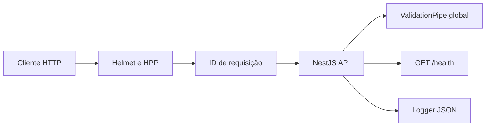
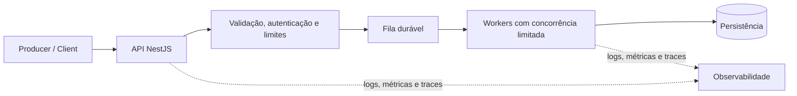

# Arquitetura e decisões

## Objetivo

O serviço receberá eventos via HTTP, confirmará a aceitação quando eles estiverem protegidos contra perda, e os processará em workers assíncronos. A arquitetura será construída em etapas para tornar explícitos os limites de entrega, falha e recuperação.

## Fluxo implementado hoje

Hoje o único endpoint de aplicação é `GET /health`. Não existe ingestão de eventos, fila, worker ou banco de dados.

## Fluxo futuro pretendido

A fila e a persistência ainda são decisões a implementar. O desenho acima representa o fluxo pretendido, não uma garantia atual do serviço.

## Decisões atuais

### Bootstrap pequeno

O bootstrap configura middlewares e validação global uma única vez. As regras de parsing de ambiente ficam em `src/config/app-config.ts`, separadas do processo de subir o servidor. Isso permite falhar cedo quando a configuração é inválida.

### Configuração explícita

`.env` é carregado no início. `NODE_ENV`, `PORT` e `CORS_ORIGINS` são interpretados por uma função tipada. A lista CORS aceita origens HTTP(S) exatas, sem caminho, query ou fragmento; lista vazia desativa CORS.

### Correlação por contexto assíncrono

Cada requisição recebe um UUID gerado pelo servidor, retornado em `x-request-id`. `AsyncLocalStorage` mantém o ID disponível nos logs criados no mesmo fluxo assíncrono. O serviço não confia em um ID enviado pelo cliente para evitar colisão e conteúdo controlado pelo chamador nos logs.

### Logs como JSON por linha

O logger escreve um objeto JSON por linha, adequado à coleta por stdout em containers. Eventos HTTP registram método, status e duração, sem URL, query string, headers ou corpo, reduzindo a chance de gravar tokens e dados pessoais por acidente.

### API desacoplada do transporte de eventos

Quando a ingestão for criada, controller, aplicação e domínio devem depender de uma abstração de publicação. A API não deve conhecer detalhes internos do BullMQ; isso deixa possível testar regras sem Redis e substituir infraestrutura sem alterar o contrato HTTP.

## Propriedades arquiteturais a preservar

- Responder `202 Accepted` somente depois de a fila confirmar que a mensagem está durável.
- Projetar consumidores para entrega pelo menos uma vez; não prometer processamento exatamente uma vez.
- Tornar efeitos dos workers idempotentes para tolerar redelivery e retries.
- Limitar concorrência e tamanho de payload para que a sobrecarga resulte em backpressure controlado.
- Propagar IDs de correlação para fila e worker sem usar dados pessoais como identificador.
- Manter readiness distinta de liveness quando a aplicação depender de Redis e banco.

## Estrutura atual do código

| Caminho | Responsabilidade |
| --- | --- |
| `src/main.ts` | Carrega ambiente, configura Nest, HTTP security middleware, validação e CORS. |
| `src/create-app.ts` | Monta a aplicação HTTP para execução e testes com a mesma configuração. |
| `src/events/dto/` | Contratos versionados e validação estrita dos eventos de entrada. |
| `src/config/app-config.ts` | Valida e transforma variáveis de ambiente. |
| `src/app.module.ts` | Registra controllers e middleware de contexto. |
| `src/app.controller.ts` | Endpoint mínimo de health. |
| `src/observability/` | Contexto assíncrono de requisição e logger estruturado. |
