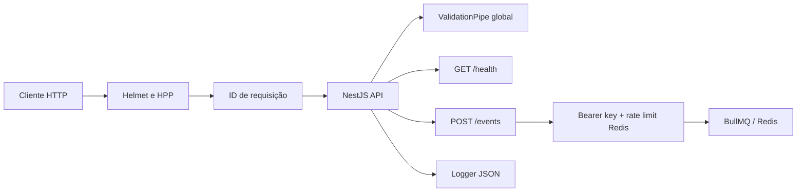
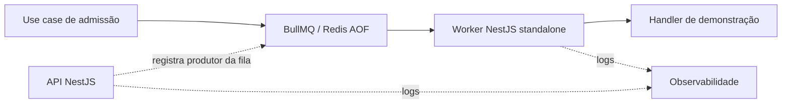

# Arquitetura e decisões

## Objetivo

O serviço receberá eventos via HTTP, confirmará a aceitação quando eles estiverem protegidos contra perda, e os processará em workers assíncronos. A arquitetura será construída em etapas para tornar explícitos os limites de entrega, falha e recuperação.

## Fluxo HTTP implementado hoje

`GET /health` e `POST /events` estão disponíveis. A rota de ingestão usa DTO estrito, autenticação Bearer, rate limit Redis compartilhado e o caso de uso de admissão. Ainda não há persistência de domínio.

## Fluxo assíncrono implementado até aqui

O consumidor tem limite de concorrência por processo, revalida os jobs e aplica o handler de demonstração. O `202 Accepted` indica confirmação da fila, não conclusão do worker nem garantia de perda zero. A configuração local usa AOF com `appendfsync everysec`, que admite perda de até cerca de um segundo em falha abrupta; o perfil de produção depende do RPO requerido.

O processo do worker inicia com `npm run start:worker:dev` e pode ser escalado separadamente da API. `WORKER_CONCURRENCY` limita jobs ativos por processo, não globalmente. Com várias réplicas, a concorrência agregada e a pressão em Redis/dependências crescem; valores devem vir de medições, não de uma alegação de throughput sem benchmark.

O `POST /events` exige `Authorization: Bearer <INGEST_API_KEY>`. A chave é única para o ambiente nesta versão; não há identidade individual, autorização multi-tenant ou rotação independente. O rate limit usa 30 requisições por IP em 60 segundos, com bloqueio de 60 segundos. O contador Lua é atômico e compartilhado pelo Redis. A janela fixa pode permitir rajadas nos limites entre janelas; essa escolha inicial deve ser reavaliada com tráfego medido.

O storage do rate limit falha fechado: se Redis não conseguir contar a chamada, a API retorna `503`. Atrás de proxy, o IP considerado pelo Express depende da configuração explícita de proxy confiável; o serviço não confia em `X-Forwarded-For` arbitrário.

A atualização e o bloqueio do contador são feitos num script Lua curto carregado via `ioredis.defineCommand`. Ele permite ramificar no resultado do incremento sem voltar ao cliente entre leitura e escrita. As chaves ficam no mesmo hash slot para uso futuro com Redis Cluster. O script executa atomicamente, mas não dá garantia de persistência ou disponibilidade do Redis; também bloqueia outros comandos enquanto roda e deve permanecer barato.

## Estratégia de deploy e escala (proposta)

O repositório demonstra a arquitetura e as decisões em ambiente local. Não faremos deploy permanente em nuvem como parte do portfólio: manter serviços gerenciados e tráfego contínuo gera custos, e não é necessário para demonstrar que os componentes podem escalar. A proposta abaixo descreve um caminho de evolução, não infraestrutura já provisionada ou validada.

### Como escalar na AWS com ECS

- Publicar API e workers como imagens de container e executá-los como serviços ECS separados. Assim, a API escala por demanda HTTP, enquanto workers escalam de forma independente conforme o backlog e a taxa de processamento.
- Usar um Application Load Balancer para entrada HTTP e manter as tarefas e dependências em uma rede privada, expondo somente os pontos de entrada necessários.
- Substituir Redis local por uma oferta gerenciada compatível com Redis/Valkey, em configuração multi-AZ escolhida conforme RPO, disponibilidade, throughput e custo. Validar previamente compatibilidade e semântica requeridas pelo BullMQ.
- Armazenar segredos fora das imagens e da configuração versionada; centralizar logs e métricas para acompanhar latência, erros, saturação e idade/profundidade da fila.
- Definir autoscaling dos workers com métricas de backlog e capacidade de processamento, com limites para concorrência e custo. Escalar somente por CPU pode reagir tarde quando a fila cresce antes de a CPU saturar.

### Como escalar na GCP

A mesma separação entre API e consumidores se aplica: empacotar cada processo em container, usar serviços gerenciados de execução apropriados para processos HTTP e consumidores contínuos, e conectar ambos a uma instância Redis compatível gerenciada. A escolha entre serviços de containers, Kubernetes ou VMs depende dos requisitos de execução contínua, controle operacional e custo; deve ser validada quando a implantação for realmente planejada. Métricas de backlog, segredos gerenciados, rede privada, logs e alertas continuam necessários.

### Decisões que precedem produção

Uma implantação real exige fechar RPO/RTO, retenção e deduplicação, capacidade e política de escala, alta disponibilidade do Redis, estratégia de backup/recuperação, segurança de rede, orçamento e observabilidade. BullMQ depende do Redis para coordenação dos jobs; escalar API e workers horizontalmente não remove esse componente compartilhado nem seus limites. Por isso, a documentação de produção será aprofundada quando os workers, o processamento idempotente e as políticas operacionais estiverem implementados.

## Decisões atuais

### Bootstrap pequeno

O bootstrap configura middlewares e validação global uma única vez. As regras de parsing de ambiente ficam em `src/config/app-config.ts`, separadas do processo de subir o servidor. Isso permite falhar cedo quando a configuração é inválida.

### Configuração explícita

`.env` é carregado no início. `NODE_ENV`, `PORT` e `CORS_ORIGINS` são interpretados por uma função tipada. A lista CORS aceita origens HTTP(S) exatas, sem caminho, query ou fragmento; lista vazia desativa CORS.

### Correlação por contexto assíncrono

Cada requisição recebe um UUID gerado pelo servidor, retornado em `x-request-id`. `AsyncLocalStorage` mantém o ID disponível nos logs criados no mesmo fluxo assíncrono. O serviço não confia em um ID enviado pelo cliente para evitar colisão e conteúdo controlado pelo chamador nos logs.

### Logs como JSON por linha

O logger escreve um objeto JSON por linha, adequado à coleta por stdout em containers. Eventos HTTP registram método, status e duração, sem URL, query string, headers ou corpo, reduzindo a chance de gravar tokens e dados pessoais por acidente.

### API desacoplada do transporte de eventos

Controller e aplicação dependem de uma abstração de admissão; a API não conhece detalhes internos do BullMQ. Isso permite testar regras sem Redis e trocar infraestrutura sem alterar o contrato HTTP.

## Propriedades arquiteturais a preservar

- Responder `202 Accepted` somente depois de a fila confirmar que a mensagem está durável.
- Projetar consumidores para entrega pelo menos uma vez; não prometer processamento exatamente uma vez.
- Tornar efeitos dos workers idempotentes para tolerar redelivery e retries.
- Usar `eventId` como identidade estável do evento; comparar fingerprint SHA-256 do envelope canônico para distinguir retry idêntico de reutilização conflitante do ID.
- Limitar concorrência e tamanho de payload para que a sobrecarga resulte em backpressure controlado.
- Tratar retries como entrega pelo menos uma vez; o handler precisa persistir uma chave de idempotência junto aos efeitos antes de afirmar processamento seguro.
- Propagar IDs de correlação para fila e worker sem usar dados pessoais como identificador.
- Manter readiness distinta de liveness quando a aplicação depender de Redis e banco.

## Estrutura atual do código

| Caminho | Responsabilidade |
| --- | --- |
| `src/main.ts` | Carrega ambiente, configura Nest, HTTP security middleware, validação e CORS. |
| `src/create-app.ts` | Monta a aplicação HTTP para execução e testes com a mesma configuração. |
| `src/events/dto/` | Contratos versionados e validação estrita dos eventos de entrada. |
| `src/events/application/` | Caso de uso e porta para admissão idempotente desacoplada do broker. |
| `src/events/queue/` | Adapter BullMQ que grava o envelope e fingerprint no job Redis usando `eventId` como `jobId`. |
| `src/config/app-config.ts` | Valida e transforma variáveis de ambiente. |
| `src/app.module.ts` | Registra controllers e middleware de contexto. |
| `src/app.controller.ts` | Endpoint mínimo de health. |
| `src/events/events.controller.ts` | Contrato HTTP de ingestão, respostas `202`/`409`/`503` e throttle específico. |
| `src/security/` | Guard de chave Bearer e storage Redis atômico para o Throttler. |
| `src/security/rate-limiting/scripts/` | Script Lua do contador e bloqueio da janela fixa. |
| `src/observability/` | Contexto assíncrono de requisição e logger estruturado. |

## Registro de decisão: nuvem como desenho, não como requisito do portfólio

**Decisão:** documentar uma estratégia plausível de implantação e escala em nuvem, sem provisionar recursos pagos neste projeto. **Motivo:** demonstrar compreensão de separação de serviços, escalabilidade independente, dependências compartilhadas e trade-offs operacionais sem criar custo recorrente desnecessário. **Revisão:** após workers, idempotência e observabilidade operacional, detalhar um caminho de produção com estimativas e requisitos explícitos antes de qualquer implantação.
